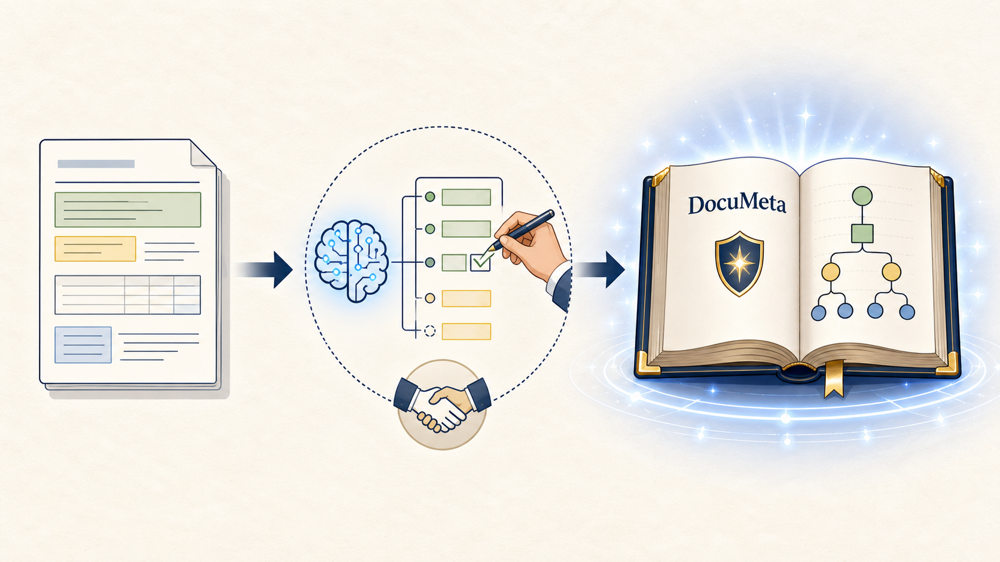
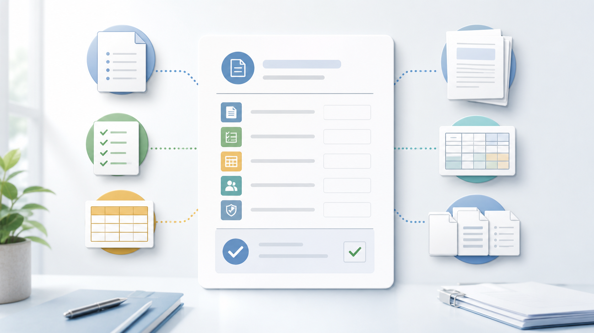
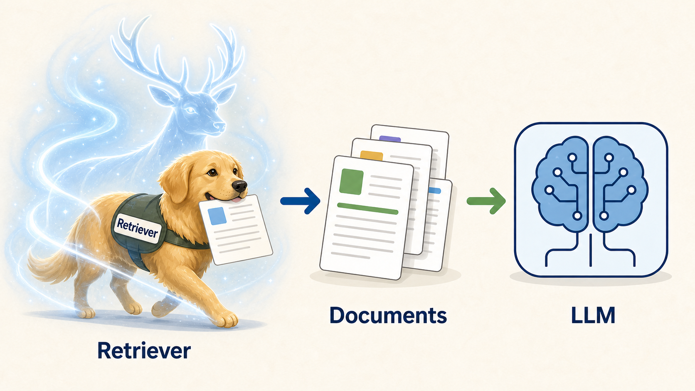
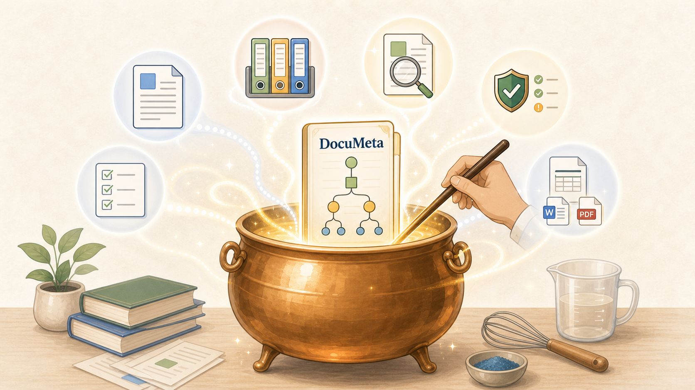
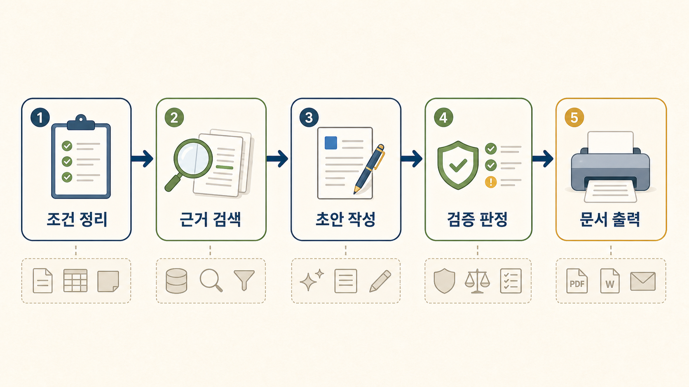

# 오픈소스로 만드는 AI 디지털 글쓰기

조직형 AI 문서 작성 흐름과 DocuMeta, RAG, 오픈소스 도구

김호성

---

## 문장과 문서 사이의 마법

AI가 문서를 대신 쓰는 것이 아니라, 문서가 만들어지는 길을 정리한다.

::: {.hero-visual}

:::

---

## 1부: 문서의 규칙과 숨은 질서

좋은 문장보다 먼저, 업무 문서가 무엇으로 성립하는지 본다.

::: {.agenda}

- 문장만으로 부족한 조직 문서
- 업무 문서를 이루는 조건
- 문서 속 숨은 <표준 주문서> docu meta
- 근거를 불러오는 <패트로누스> RAG
:::

---

## 잘 쓴 문장과 아직 부족한 문서

GPT는 이미 문장을 잘 쓴다. 하지만 조직 문서는 문장만으로 끝나지 않는다.

- 누가 읽는가
- 어떤 근거를 따르는가
- 빠지면 안 되는 항목은 무엇인가
- 최종 파일은 어떤 형식인가

---

## 문서를 이루는 네 가지 규칙

업무 문서는 문장력이 아니라 조건의 묶음으로 관리된다.

- 대상: 누가 읽고 누가 행동하는가
- 형식: 표가 필요한가, 공문 구조가 필요한가
- 근거: 어떤 지침과 계획을 따라야 하는가
- 출력: 최종 문서는 어디에 제출되는가

---

## 첫상대는 누구로 할 것인가?

제품화 대상으로는 자주 나오고 조건이 명확한 문서부터 시작한다.

- 문서: 내부 업무시스템 점검 안내문
- 일정: 2026년 6월 3일 19:00-22:00
- 영향 서비스: 전자결재, 문서 열람
- 사용자 조치: 문서 저장, 긴급 결재 사전 처리
- 문의처: 정보화지원팀

---

## 시연 1: 챗지피티에 바로 맡기면

::: {.demo-box}
결과는 꽤 그럴듯하다.

- 표도 만들고 문장도 자연스럽다.
- 하지만 그 표가 승인된 양식인지는 모른다.
- 값의 출처가 분리되지 않는다.
- 실제 담당 부서와 다른 내용이 섞일 수 있다.
:::

---

## 문서 속 숨은 <표준 주문서> docu meta

자동화는 문서 원문에서 바로 시작되지 않는다. 먼저 문서 안의 반복 구조를 태깅해야 한다.

::: {.image-top-layout}

- 문서: 안내문 전체 본문
- 태깅: 제목, 수신, 일정, 영향 서비스, 사용자 조치, 문의처
- docu meta: 필수 슬롯, 표 구조, 근거, 검증 규칙, 출력 형식
- 자동화: 입력, 검색, 생성, 검증, 출력 조정
:::

---

## docu meta는 무엇을 고정하는가

docu meta는 문서를 만들기 전에 미리 고정해두는 조건 묶음이다.

- 필수 슬롯
- 근거
- 검증 규칙
- 출력 형식

MD, YAML로 시작해서 DB와 관리자 화면으로 확장할 수 있다.

---

## 시연 2: 짧은 docu meta만 붙여도

::: {.demo-box}
문서의 기준이 먼저 고정되기 시작한다.

- 필수 항목이 먼저 보인다.
- 표 구조와 출력 형식이 흔들리지 않는다.
- 값의 출처를 나중에 연결할 자리도 분명해진다.
:::

---

## AI 글쓰기의 <패트로누스> RAG

AI가 마음대로 쓰지 않게 붙잡아주는 수호 장치이다. RAG는 필요한 근거를 세워준다.

- `R`etrieval: 작업계획서, 운영지침, 이전 안내문 같은 근거를 찾는다.
- `A`ugmented: 찾은 근거를 초안 작성 맥락에 붙인다.
- `G`eneration: 근거를 바탕으로 초안을 만든다.

우리가 쓰는 RAG는 가드레일이 설 수 있게 받쳐주는 `스캐폴딩`이다.

---

## RAG에 대한 흔한 오해

| 오해                                        | 답                                                                                            |
| ------------------------------------------- | --------------------------------------------------------------------------------------------- |
| RAG는 벡터 DB와 같은 말인가?                | 아니다. 벡터 DB는 자주 쓰는 저장소일 뿐이고, RAG는 검색된 근거를 생성 흐름에 붙이는 방식이다. |
| RAG가 환각을 만든다고 봐야 하는가?          | 아니다. 환각을 없애주지는 않지만, 근거를 붙여 환각을 줄이는 데 도움을 준다.                   |
| RAG만 붙이면 문서 품질이 저절로 좋아지는가? | 아니다. 문서 조건, 근거 품질, 검증 규칙이 함께 있어야 안정된다.                               |
| 공문서에도 RAG가 꼭 필요한가?               | 모든 문서에 필수는 아니지만, 근거가 바뀌고 확인 책임이 있는 공문서에는 거의 필수에 가깝다.    |

---

## 1부 요약

::: {.summary}

- 공문서는 문장만으로 완성되지 않는다.
- 문서의 반복 구조를 태깅하면 docu meta가 된다.
- docu meta는 문서 조건과 출력 기준을 먼저 고정한다.
- RAG는 그 기준 위에 필요한 근거를 찾아 붙인다.
:::

---

## 2부: 배운 규칙이 흐름이 되는 시간

앞에서 만든 문서 조건이 실제 제품과 오픈소스 흐름으로 어떻게 확장되는지 살펴본다.

::: {.agenda}

- 작업 경로를 남기는 <마법사의 지도>
- AI와 사람이 함께 만드는 docu meta
- 여러 출력으로 이어지는 문서 조건
- 역할로 고르는 오픈소스 도구
- 하나의 제품으로 묶이는 구성요소
:::

---

## AI 디지털 글쓰기의 <마법사의 지도>

완성본만 보는 것이 아니라, 문서가 어떤 조건에서 출발해 어떤 근거와 검증을 거쳤는지 따라갈 수 있어야 한다.

- 조건: 필수 슬롯, 누락값, 작성 대상
- 근거: 사용한 문서 제목, 인용 위치, 적용 이유
- DocuMeta: 근거와 연결된 슬롯 값, 표 계약, 출력 대상
- 검증: 통과, 수정, 보류 판정과 사유
- 출력: 제출 형식, 변환 로그, 최종 파일

---

## 시연 3: DocuMeta 프레임 생성

이 단계에서는 샘플 문서에서 템플릿 초안을 만들고, 사람이 검토할 DocuMeta 프레임으로 고정하는 과정을 확인한다.

::: {.demo-box}

- 샘플 문서 입력
- LLM 템플릿 초안 생성
- 슬롯 후보 확인
- table_contracts 후보 확인
- QMD/TYP/HWPX placeholder 확인
- 사람이 검토해 DocuMeta 프레임 확정
:::

### 강사용 코멘트

여기서는 문장 초안보다 DocuMeta 프레임이 더 중요하다. docu meta는 사람이 손본 문서 조건을 LLM과 출력 어댑터가 함께 읽을 수 있게 만든 구조화 입력이고, 시연 3의 핵심은 샘플 문서에서 템플릿 초안을 만들고 사람이 검토할 DocuMeta 프레임을 확정하는 장면이다. RAG는 시연 4에서 근거 문서를 가져와 빈 슬롯을 채우고, 검증 게이트는 이 DocuMeta를 출력으로 넘길지 결정한다.

---

## docu meta의 마법 레시피

AI가 반복 구조를 먼저 찾아내고, 사람이 기준을 확정해 <표준 주문서>로 만든다.

::: {.image-top-layout}

1. 샘플 문서를 고르고, AI가 구조 초안을 만든다.
2. AI가 제목, 수신, 일정, 표, 문의처처럼 반복되는 자리를 찾는다.
3. AI가 슬롯 후보를 나누고, 사람이 필수와 선택을 조정한다.
4. AI가 관련 근거를 추천하고, 사람이 검증 규칙을 확정한다.
5. AI가 출력 조건을 점검하고, 사람이 최종 문서 형식을 승인한다.
:::

---

## 시연 4: RAG와 글쓰기 빌드

이 단계에서는 같은 문서 조건이 출력 형식마다 어떻게 이어지는지 실제 결과 화면으로 확인한다.

::: {.demo-box}

- DocuMeta 출력 계약 확인
- 근거 문서 검색
- DocuMeta 슬롯 완성
- 검증 판정
- 출력 어댑터 프롬프트 확인
- Quarto 출력 확인
- Typst 조판 결과 확인
- HWPX 제출 문서 연결 확인
:::

### 강사용 코멘트

시연 4에서는 템플릿 초안을 다시 만들지 않는다. 시연 4에서 완성된 DocuMeta가 그대로 출력 어댑터로 넘어온 상태를 보여준다. 특히 DocuMeta의 `table_contracts`가 결재 표, 점검 정보 표, 하단 메타데이터 표로 표현되는 장면을 보여준다. Quarto는 HTML 검토본, Typst는 PDF 조판본, HWPX는 제출 파일 후보라는 역할 구분을 강조한다.

---

## 하나의 주문서, 세 가지 출력

만들어진 docu meta는 지속적으로 다양한 출력 형식을 이어주는 문서 조건이다.

- 같은 문서 조건이 Quarto, Typst, HWPX로 이어진다.
- 완성된 docu meta의 표 계약이 공문서 표로 표현된다.
- Quarto와 Typst는 중간 산출과 조판 흐름을 맡는다.
- 마지막에는 배포와 제출에 맞는 HWPX 문서까지 연결된다.
- 시연 4의 RAG 검증 판정이 같은 시연 안의 출력 여부를 결정한다.

---

## 도구선택도 역할 구분 하기 나름

오픈소스 이름부터 고르면 제품이 도구에 끌려간다.

- 조건 관리는 사람이 바꿔도 추적 가능해야 한다.
- 검색은 어떤 근거를 썼는지 보여줘야 한다.
- 생성은 문서 조건과 근거 안에서 움직여야 한다.
- 검증은 결과를 통과, 수정, 보류로 나눠야 한다.
- 출력은 제출 가능한 형식까지 이어져야 한다.

---

## 역할별 오픈소스 후보

나눈 역할마다 선택할 수 있는 도구가 달라진다.

::: {.full-table}

| 역할        | 후보                                                  |
| ----------- | ----------------------------------------------------- |
| 조건 관리   | YAML, JSON Schema, Baserow, NocoDB                    |
| RAG 연결    | FAISS, LangChain, LangGraph, pgvector                 |
| 임베딩/검색 | Hugging Face, sentence-transformers, Qdrant, Chroma   |
| 저장소      | PostgreSQL, LanceDB, OpenSearch                       |
| 모델 실행   | Ollama, vLLM, llama.cpp, Hugging Face, OpenAI 호환 API |
| 제품 API    | FastAPI, PostgreSQL                                   |
| 출력        | Quarto, Typst, Pandoc, HWPX 어댑터                    |
:::

---

## 오픈소스로 만드는 AI 디지털 글쓰기 시스템

결국 제품은 한 도구가 아니라 연결된 컴포넌트의 조합이다.

- 작성 화면: 사용자가 문서 유형과 값을 넣는 곳
- docu meta: 문서 조건과 슬롯 구조를 잡는 곳
- RAG: 근거와 선례를 찾는 곳
- LLM: 초안과 표현 후보를 만드는 곳
- 검증 게이트: 통과, 수정, 보류를 나누는 곳
- 출력 어댑터: Quarto, Typst, HWPX로 내보내는 곳

---

## 마지막에 남는 것은 통과한 문서

::: {.summary}

- 출발점은 문장이 아니라 문서 조건이다.
- 자동화는 문서에서 태깅을 거쳐 docu meta로 간다.
- RAG와 검증은 품질을 통제하는 장치다.
- 최종 문서는 조건, 근거, 검증을 통과한 결과다.
- 제품화는 문서 하나를 끝까지 통과시키는 데서 시작한다.
:::
